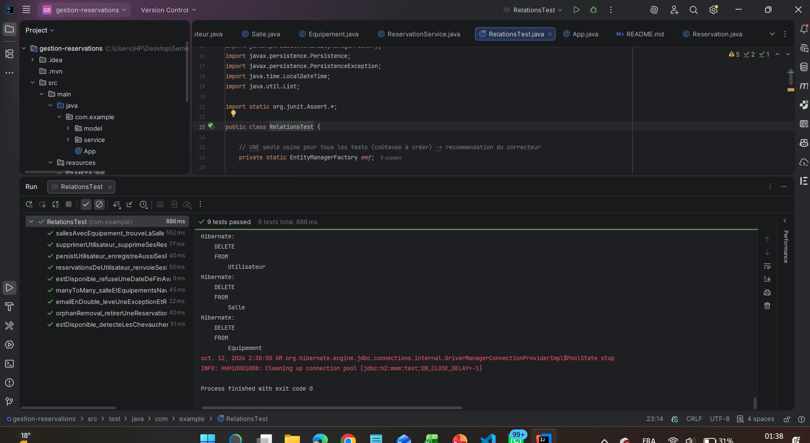
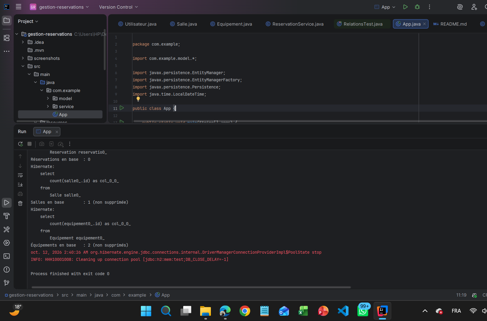

# TP3 – Gestion des réservations : relations JPA, cascades et orphelins

Application Java SE qui gère des **utilisateurs**, des **salles**, des **réservations** et des **équipements** avec JPA / Hibernate et une base **H2 en mémoire**. Le TP met en œuvre les relations `@OneToMany`, `@ManyToOne` et `@ManyToMany`, les **cascades** et la **suppression des orphelins**.

## Technologies

| Outil | Version |
|---|---|
| Java (compilation) | 11 |
| Hibernate ORM | 5.6.15.Final |
| JPA (`javax.persistence`) | 2.2 |
| H2 Database | 2.1.214 |
| JUnit | 4.13.2 |
| Maven | 3 |

## Architecture

```
src/
├── main/
│   ├── java/com/example/
│   │   ├── App.java               scénario de démonstration (création, orphelin, suppression)
│   │   ├── model/                 Utilisateur, Salle, Reservation, Equipement
│   │   └── service/               ReservationService (requêtes de recherche)
│   └── resources/META-INF/
│       └── persistence.xml
└── test/java/com/example/
    └── RelationsTest.java         9 tests JUnit
```

## Modèle de données

```
Utilisateur 1 ──── * Reservation * ──── 1 Salle * ──── * Equipement
```

| Relation | Côté propriétaire (clé étrangère) | Côté inverse (`mappedBy`) | Cascade |
|---|---|---|---|
| Utilisateur ↔ Reservation | `Reservation.utilisateur` (`utilisateur_id`) | `Utilisateur.reservations` | `ALL` + `orphanRemoval = true` |
| Salle ↔ Reservation | `Reservation.salle` (`salle_id`) | `Salle.reservations` | aucune |
| Salle ↔ Equipement | `Salle.equipements` (table `salle_equipement`) | `Equipement.salles` | `PERSIST`, `MERGE` (pas de `REMOVE`) |

Choix de conception :
- Un utilisateur **possède** ses réservations : les supprimer avec lui est logique (`ALL`), et une réservation retirée de sa liste n'a plus de raison d'exister (`orphanRemoval`).
- Un équipement est **partagé** entre plusieurs salles : pas de `REMOVE` en cascade, pour ne pas le supprimer avec une salle.
- La cascade va toujours **du parent vers l'enfant** : la salle est enregistrée explicitement, pas via la réservation.
- Les méthodes `addReservation()` / `addEquipement()` mettent à jour **les deux côtés** de chaque relation.

## Scénario de démonstration (`App`)

| Étape | Action | Résultat attendu |
|---|---|---|
| 1 | `persist(salle)` puis `persist(utilisateur)` | Utilisateur, 2 réservations, salle, 2 équipements et la table `salle_equipement` remplis |
| 2 | Retirer une réservation de `user.getReservations()` | 1 `delete from Reservation` sans appel à `remove()` (orphanRemoval) |
| 3 | `remove(utilisateur)` | Réservations supprimées, salle et équipements conservés |

Lancement :

```bash
mvn clean compile exec:java
```



## Requêtes de recherche (`ReservationService`)

- `reservationsDeUtilisateur(email)` : réservations d'un utilisateur, triées par date ;
- `sallesAvecEquipement(nom)` : salles équipées d'un équipement donné (`JOIN s.equipements`) ;
- `estDisponible(salle, debut, fin)` : vérifie qu'aucune réservation ne chevauche la période, et refuse une date de fin antérieure à la date de début.

## Tests

Une seule `EntityManagerFactory` est partagée par tous les tests (`@BeforeClass`), avec un `EntityManager` neuf par test. Les tables sont vidées après chaque test pour garantir leur indépendance.

| Test | Ce qui est vérifié |
|---|---|
| `persistUtilisateur_enregistreAussiSesReservations` | Cascade `PERSIST` et génération de l'id |
| `manyToMany_salleEtEquipementsNavigablesDansLesDeuxSens` | Relation `@ManyToMany` dans les deux sens |
| `orphanRemoval_retirerUneReservationLaSupprimeDeLaBase` | `orphanRemoval` |
| `supprimerUtilisateur_...` | Cascade `REMOVE` sans toucher la salle ni les équipements |
| `emailEnDouble_leveUneExceptionEtRollback` | Scénario d'erreur : exception et rollback |
| `reservationsDeUtilisateur_...` | Recherche et tri par date |
| `sallesAvecEquipement_...` | Recherche sur le `@ManyToMany` |
| `estDisponible_detecteLesChevauchements` | Détection des créneaux qui se chevauchent |
| `estDisponible_refuseUneDateDeFin...` | Validation des dates |

```bash
mvn clean test
```



## Démonstration vidéo

[Vidéo de démonstration](demo/demo.mp4)